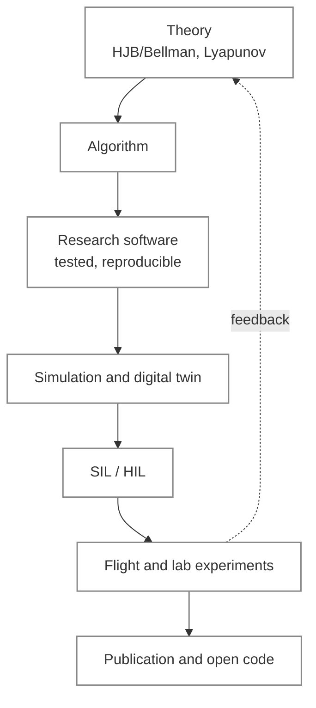

  <picture>
    <source media="(prefers-color-scheme: dark)" srcset="https://raw.githubusercontent.com/PythaLab/.github/main/profile/assets/banner-dark.svg">
    <source media="(prefers-color-scheme: light)" srcset="https://raw.githubusercontent.com/PythaLab/.github/main/profile/assets/banner-light.svg">
    
  </picture>

  
  
  
  
   
  
  
  
  
  

**PythaLab** turns theory into algorithms, algorithms into reliable software, software into simulations
and experiments, and findings into academic outputs. Claims are tested before they are believed:
reproducible code, fair baselines, and honest reporting of what works and what does not.

## Research themes

<table>
  <tr>
    <td width="50%" valign="top">
      <b>✈️ Learning-based flight control for UAVs</b> 
      Reinforcement learning grounded in HJB/Bellman optimal control for fixed-wing and VTOL aircraft,
      with 6-DOF digital twins and validation from simulation through SIL/HIL to flight.
    </td>
    <td width="50%" valign="top">
      <b>🛡️ Safe and nonlinear control</b> 
      Safety filters that preserve a baseline autopilot, approximate dynamic programming, MPC, and
      adaptive and robust control with Lyapunov (ISS/UUB) analysis.
    </td>
  </tr>
  <tr>
    <td width="50%" valign="top">
      <b>📡 Estimation and embedded systems</b> 
      Kalman filtering and sensor fusion, real-time control on microcontrollers, mechatronic test rigs
      and actuator systems.
    </td>
    <td width="50%" valign="top">
      <b>🔬 Rigorous evaluation of AI systems</b> 
      Preregistered, placebo-controlled studies of LLM coding agents and small local models, including
      falsification-based self-repair and risk-controlled claim checking.
    </td>
  </tr>
  <tr>
    <td width="50%" valign="top">
      <b>🧰 AI research infrastructure</b> 
      Local-first research workspaces, multi-agent workflows for software and science, and literature
      pipelines that turn papers into searchable, structured knowledge.
    </td>
    <td width="50%" valign="top">
      <b>🧬 Physics-informed generative modelling</b> 
      Generative models constrained by physics, with applications such as biosignal synthesis for
      prosthetic control.
    </td>
  </tr>
</table>

## Research pipeline

## Preprints

Preprints on arXiv; see each listing for status.

**UAV control**

| Title | Year |
| --- | --- |
| [Autopilot-Preserving Residual Q-Learning with HJB-Inspired Finite-Action Risk Filtering for Fixed-Wing UAV Command Supervision](https://arxiv.org/abs/2606.01397) | 2026, with B. Temiz |

**AI systems: rigorous evaluation and engineering use**

| Title | Year |
| --- | --- |
| [Requirement-Bound Verified Commissioning: A Frozen Four-Billion-Parameter Local Model as a Candidate Generator under an External Acceptance Layer with Verification and Release Authority](https://arxiv.org/abs/2609.30219) | 2026 |
| [Form, Not Content? A Preregistered, Placebo-Controlled Evaluation of Learned Error-Conditioned Self-Repair Through Prompts and Weights in Frozen Small Code Models](https://arxiv.org/abs/2607.12962) | 2026 |
| [Falsification, Not Exposure: An Internally Preregistered Placebo-Controlled Decomposition of Self-Repair Feedback in Frozen Small Code Models](https://arxiv.org/abs/2606.31511) | 2026 |
| [Selection Without Signal, Recovery Through Expression: A Measurement Study of Post-Hoc Falsification Operators for Frozen Small Code Models](https://arxiv.org/abs/2606.16999) | 2026 |
| [Scaffold, Not Vocabulary? A Controlled, Two-Tier, Pre-Registered Study of a Popperian Code-Generation Skill](https://arxiv.org/abs/2606.06454) | 2026 |
| [PYTHALAB-MERA: Validation-Grounded Memory, Retrieval, and Acceptance Control for Frozen-LLM Coding Agents](https://arxiv.org/abs/2605.08468) | 2026 |
| [Feedback-Normalized Developer Memory for Reinforcement-Learning Coding Agents: A Safety-Gated MCP Architecture](https://arxiv.org/abs/2605.01567) | 2026 |
| [Learning When to Remember: Risk-Sensitive Contextual Bandits for Abstention-Aware Memory Retrieval in LLM-Based Coding Agents](https://arxiv.org/abs/2604.27283) | 2026 |

## Research showcase

<table>
  <tr>
    <td colspan="2" align="center">
       
      Autopilot-preserving residual command supervision: a learned supervisor above an unchanged classical autopilot, with a value-guided critic and a safety filter (<a href="https://arxiv.org/abs/2606.01397">arXiv:2606.01397</a>)
    </td>
  </tr>
  <tr>
    <td width="50%" valign="top" align="center">
       
      Representative low-altitude crosswind/turbulence orbit, baseline versus residual controllers (<a href="https://arxiv.org/abs/2606.01397">arXiv:2606.01397</a>)
    </td>
    <td width="50%" valign="top" align="center">
       
      Mean RMS path error over a 20-scenario simulation benchmark (<a href="https://arxiv.org/abs/2606.01397">arXiv:2606.01397</a>)
    </td>
  </tr>
  <tr>
    <td width="50%" valign="top" align="center">
       
      Strict-validation success on a 3-task RL coding benchmark, 3 repetitions (<a href="https://arxiv.org/abs/2605.08468">arXiv:2605.08468</a>)
    </td>
    <td width="50%" valign="top" align="center">
       
      Browser-based RL laboratory used in teaching
    </td>
  </tr>
</table>

## Teaching

Courses in Python programming, artificial intelligence, a reinforcement learning control laboratory,
applied nonlinear control and capstone design, at undergraduate and graduate level; a graduate course
on large language models is in preparation. Browser-based interactive laboratories let students run
simulations and train policies without installing anything.

## Students

The lab supervises MSc research and is launching an undergraduate research programme. Each student works in a private,
supervised repository with a common structure; progress is tracked through weekly reports,
assignments with evidence-based solutions, and written reviews.

## Open work

Selected public repositories on the supervisor's account, [PhiniteLab](https://github.com/PhiniteLab):

| Area | Repositories |
| --- | --- |
| Safe control | [residual-shield](https://github.com/PhiniteLab/residual-shield) · [ReinforcementLearningControl](https://github.com/PhiniteLab/ReinforcementLearningControl) · [IntelligentNonlinearControl](https://github.com/PhiniteLab/IntelligentNonlinearControl) |
| Embedded control and estimation | [control-library-for-embedded-systems](https://github.com/PhiniteLab/control-library-for-embedded-systems) · [fast-kalman-filter](https://github.com/PhiniteLab/fast-kalman-filter) · [system-dynamic-library](https://github.com/PhiniteLab/system-dynamic-library) |
| Neural network toolboxes | Levenberg–Marquardt training in [C](https://github.com/PhiniteLab/levenberg-marquardt-nn-C-toolbox) · [C++](https://github.com/PhiniteLab/levenberg-marquardt-nn-Cpp-toolbox) · [MATLAB](https://github.com/PhiniteLab/levenberg-marquardt-nn-matlab-toolbox) |
| AI research tooling | [scaffold-skill](https://github.com/PhiniteLab/scaffold-skill) · [rl-developer-memory](https://github.com/PhiniteLab/rl-developer-memory) · [cortexmark](https://github.com/PhiniteLab/cortexmark) |

## Supervisor

Asst. Prof. Dr. Mehmet İşcan — [github.com/PhiniteLab](https://github.com/PhiniteLab) ·
phinitelab@gmail.com

---

  Toolchain: Python, PyTorch, C/C++, MATLAB, FastAPI, React, SQLite, Ollama, uv · Student repositories are private.

