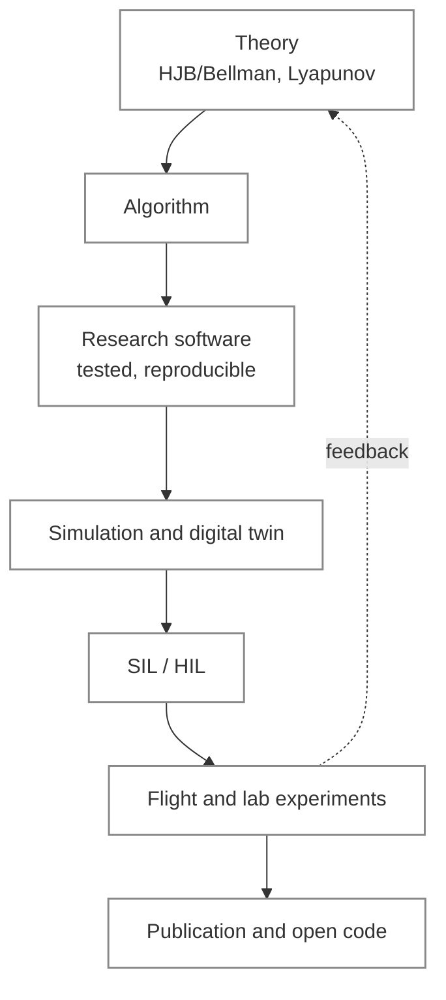

  <picture>
    <source media="(prefers-color-scheme: dark)" srcset="https://raw.githubusercontent.com/PythaLab/.github/main/profile/assets/banner-dark.svg">
    <source media="(prefers-color-scheme: light)" srcset="https://raw.githubusercontent.com/PythaLab/.github/main/profile/assets/banner-light.svg">
    
  </picture>

  
  
  
  
   
  
  
  
  
  
  
  

**PythaLab** turns theory into algorithms, algorithms into reliable software, software into simulations
and experiments, and findings into academic outputs. Claims are tested before they are believed:
reproducible code, fair baselines, and honest reporting of what works and what does not.

## Research themes

<table>
  <tr>
    <td width="50%" valign="top">
      <b>✈️ UAV learning-based flight control</b> 
      Reinforcement learning grounded in HJB/Bellman optimal control for fixed-wing and VTOL aircraft,
      with 6-DOF digital twins and validation from simulation through SIL/HIL to flight.
    </td>
    <td width="50%" valign="top">
      <b>🛡️ Safe and nonlinear control</b> 
      Safety filters that preserve a baseline autopilot, approximate dynamic programming, MPC, and
      adaptive and robust control with Lyapunov (ISS/UUB) analysis.
    </td>
  </tr>
  <tr>
    <td width="50%" valign="top">
      <b>📡 Estimation and embedded systems</b> 
      Kalman filtering and sensor fusion, real-time control on microcontrollers, mechatronic test rigs
      and actuator systems.
    </td>
    <td width="50%" valign="top">
      <b>🔬 Rigorous evaluation of AI systems</b> 
      Preregistered, placebo-controlled studies with falsification-based checks of LLM coding agents
      and small local models.
    </td>
  </tr>
  <tr>
    <td width="50%" valign="top">
      <b>🧠 Memory and acceptance control for coding agents</b> 
      Validation-grounded memory and retrieval for frozen-LLM coding agents, with safety-gated
      acceptance of generated code.
    </td>
    <td width="50%" valign="top">
      <b>⚙️ LLMs in the engineering loop</b> 
      Verified commissioning: a frozen local model proposes candidates and an external acceptance
      layer holds verification and release authority.
    </td>
  </tr>
  <tr>
    <td width="50%" valign="top">
      <b>🧰 AI research infrastructure</b> 
      Local-first research workspaces, multi-agent workflows for software and science, and literature
      pipelines that turn papers into searchable, structured knowledge.
    </td>
    <td width="50%" valign="top">
      <b>🧬 Physics-informed generative modelling</b> 
      Generative models constrained by physics, with applications such as biosignal synthesis for
      prosthetic control.
    </td>
  </tr>
</table>

## Research pipeline

## Funded projects

Principal investigator of two funded, ongoing TÜBİTAK projects.

| Programme | Project |
| --- | --- |
| TÜBİTAK 1001 | A tilt-trirotor VTOL controller enabling task-oriented transfer and rapid adaptation: hardware-in-the-loop and real-world validation of a meta-learning-based reinforcement learning architecture |
| TÜBİTAK 3501 | HJB-regularised soft actor-critic flight control for fixed-wing UAVs with UKF-based online cable-actuator parameter estimation |

## Research in motion

Animations are generated from published result files, public demo footage and live teaching sites;
captions keep the limits of each result.

<table>
  <tr>
    <td width="50%" valign="top" align="center">
       
      Fixed-wing UAV 6-DOF digital twin: take-off roll and initial climb, rendered live from simulator telemetry (<a href="https://arxiv.org/abs/2606.01397">arXiv:2606.01397</a>). Aircraft model: Ro3code <code>aircraft_3d_animation</code> SAAB Gripen STL meshes, GPL-3.0 (visual shell only, not aerodynamic evidence).
    </td>
    <td width="50%" valign="top" align="center">
       
      One scenario, not a monotone improvement: the Q residual ends worse than the baseline here (RMS reference error 492.4 m vs 420.1 m; HJB residual 57.4 m). Inset: 20-scenario mean RMS error from the stored benchmark (<a href="https://arxiv.org/abs/2606.01397">arXiv:2606.01397</a>).
    </td>
  </tr>
  <tr>
    <td colspan="2" align="center">
       
      Autopilot-preserving residual command supervision: a learned supervisor above an unchanged classical autopilot, with a value-guided critic and a safety filter (<a href="https://arxiv.org/abs/2606.01397">arXiv:2606.01397</a>)
    </td>
  </tr>
  <tr>
    <td width="50%" valign="top" align="center">
       
      Cumulative proxy reward over 40 offline-replay events for seven policies (the oracle is a non-deployable upper bound). n = 2 seeds; smoke-scale replay with proxy rewards, not live deployment (<a href="https://arxiv.org/abs/2604.27283">arXiv:2604.27283</a>).
    </td>
    <td width="50%" valign="top" align="center">
       
      Two QLoRA adapters on a 1.5B code model, content-bearing versus shuffled pairs: both reach near-zero training loss. On the 40-unit public-tier screen, best-of-4 unlocks were 8 (baseline), 8 (content) and 10 (shuffled); content-attributable superiority was not confirmed, and the paper states this is not evidence of equivalence (<a href="https://arxiv.org/abs/2607.12962">arXiv:2607.12962</a>).
    </td>
  </tr>
  <tr>
    <td width="50%" valign="top" align="center">
       
      Strict-validation success on a small hard RL coding subset (3 tasks × 3 repetitions, 3-attempt budget): REFINE_B1 0/9, MERA 8/9, GRACE 0/9. Descriptive; the paper disclaims general code synthesis (<a href="https://arxiv.org/abs/2605.08468">arXiv:2605.08468</a>).
    </td>
    <td width="50%" valign="top" align="center">
       
      PYTHALAB-MERA terminal run: validation-gated accept/repair loop around a frozen local LLM. The fake backend demonstrates the validation loop, not model quality; code private (<a href="https://arxiv.org/abs/2605.08468">arXiv:2605.08468</a>).
    </td>
  </tr>
  <tr>
    <td width="50%" valign="top" align="center">
       
      Interactive graduate teaching site (MKT6108): a sentence travelling through GPT-2, real model traces (<a href="https://phinitelab.github.io/mkt6108-online-sessions/">live site</a>).
    </td>
    <td width="50%" valign="top" align="center">
       
      Browser-based RL control laboratory (MKT4822), running fully in the browser via Pyodide: Q-learning on Cliff Walking (<a href="https://phinitelab.github.io/mkt4822-online-sessions/">live site</a>).
    </td>
  </tr>
  <tr>
    <td colspan="2" align="center">
       
      CortexMark: local PDF→Markdown conversion for research literature, open source (<a href="https://github.com/PhiniteLab/cortexmark">repository</a>). Real session; the excerpt shows raw output on a two-column paper, including extraction artefacts.
    </td>
  </tr>
</table>

## Preprints

Preprints on arXiv; see each listing for status.

**UAV control**

| Title | Year |
| --- | --- |
| [Autopilot-Preserving Residual Q-Learning with HJB-Inspired Finite-Action Risk Filtering for Fixed-Wing UAV Command Supervision](https://arxiv.org/abs/2606.01397) | 2026, with B. Temiz |

**AI systems: rigorous evaluation and engineering use**

| Title | Year |
| --- | --- |
| [Requirement-Bound Verified Commissioning: A Frozen Four-Billion-Parameter Local Model as a Candidate Generator under an External Acceptance Layer with Verification and Release Authority](https://arxiv.org/abs/2609.30219) | 2026 |
| [Form, Not Content? A Preregistered, Placebo-Controlled Evaluation of Learned Error-Conditioned Self-Repair Through Prompts and Weights in Frozen Small Code Models](https://arxiv.org/abs/2607.12962) | 2026 |
| [Falsification, Not Exposure: An Internally Preregistered Placebo-Controlled Decomposition of Self-Repair Feedback in Frozen Small Code Models](https://arxiv.org/abs/2606.31511) | 2026, accepted in *Software: Practice and Experience* (Wiley) |
| [Selection Without Signal, Recovery Through Expression: A Measurement Study of Post-Hoc Falsification Operators for Frozen Small Code Models](https://arxiv.org/abs/2606.16999) | 2026 |
| [Scaffold, Not Vocabulary? A Controlled, Two-Tier, Pre-Registered Study of a Popperian Code-Generation Skill](https://arxiv.org/abs/2606.06454) | 2026 |
| [PYTHALAB-MERA: Validation-Grounded Memory, Retrieval, and Acceptance Control for Frozen-LLM Coding Agents](https://arxiv.org/abs/2605.08468) | 2026 |
| [Feedback-Normalized Developer Memory for Reinforcement-Learning Coding Agents: A Safety-Gated MCP Architecture](https://arxiv.org/abs/2605.01567) | 2026 |
| [Learning When to Remember: Risk-Sensitive Contextual Bandits for Abstention-Aware Memory Retrieval in LLM-Based Coding Agents](https://arxiv.org/abs/2604.27283) | 2026 |

## Teaching

Undergraduate and graduate courses:

- **MKT2151** Python Programming
- **MKT3432** Introduction to Artificial Intelligence
- **MKT4822** Reinforcement Learning Control Laboratory
- **MKT6123** Applied Nonlinear Control (graduate)
- **MKT4000** Capstone Design
- **MKT6108** graduate course on large language models and agentic engineering (in preparation)

Live interactive sites, public and runnable in the browser without installation:
[MKT3432 machine learning and CNN lab](https://phinitelab.github.io/mkt3432-online-sessions/) ·
[MKT4822 reinforcement learning control lab](https://phinitelab.github.io/mkt4822-online-sessions/) ·
[MKT6108 how LLMs work, with real GPT-2 traces](https://phinitelab.github.io/mkt6108-online-sessions/).

Lecture videos on [YouTube](https://www.youtube.com/@memo8301), with playlists on Python, C, C++, C#,
multithreading and reinforcement learning.

## Students

1 active MSc thesis; the undergraduate research programme is launching. Each student works in a private,
supervised repository with a common structure; progress is tracked through weekly reports,
assignments with evidence-based solutions, and written reviews.

## Industry

Industry training in model-based systems engineering (MBSE).

## Open work

Selected public repositories on the supervisor's account, [PhiniteLab](https://github.com/PhiniteLab):

| Area | Repositories |
| --- | --- |
| Safe control | [residual-shield](https://github.com/PhiniteLab/residual-shield) · [ReinforcementLearningControl](https://github.com/PhiniteLab/ReinforcementLearningControl) · [IntelligentNonlinearControl](https://github.com/PhiniteLab/IntelligentNonlinearControl) |
| Embedded control and estimation | [control-library-for-embedded-systems](https://github.com/PhiniteLab/control-library-for-embedded-systems) · [fast-kalman-filter](https://github.com/PhiniteLab/fast-kalman-filter) · [system-dynamic-library](https://github.com/PhiniteLab/system-dynamic-library) · [system-dynamic-library-in-cpp](https://github.com/PhiniteLab/system-dynamic-library-in-cpp) · [kalman-filter-design-in-cpp](https://github.com/PhiniteLab/kalman-filter-design-in-cpp) · [kalman-filter-design-in-Matlab](https://github.com/PhiniteLab/kalman-filter-design-in-Matlab) |
| STM32 Nucleo applications | [stm32-dynamixel-ax12-servo-application](https://github.com/PhiniteLab/stm32-dynamixel-ax12-servo-application) · [stm32-nucleo-analog-pitot-tube-application](https://github.com/PhiniteLab/stm32-nucleo-analog-pitot-tube-application) · [stm32-nucleo-ublox-gps-application](https://github.com/PhiniteLab/stm32-nucleo-ublox-gps-application) · [stm32-nucleo-uart-comm-application](https://github.com/PhiniteLab/stm32-nucleo-uart-comm-application) · [stm32-nucleo-temperature-application](https://github.com/PhiniteLab/stm32-nucleo-temperature-application) |
| Serial communication tools | [phi-serial-plotter](https://github.com/PhiniteLab/phi-serial-plotter) · [serial-comm-port](https://github.com/PhiniteLab/serial-comm-port) |
| Neural network toolboxes | Levenberg–Marquardt training in [C](https://github.com/PhiniteLab/levenberg-marquardt-nn-C-toolbox) · [C++](https://github.com/PhiniteLab/levenberg-marquardt-nn-Cpp-toolbox) · [MATLAB](https://github.com/PhiniteLab/levenberg-marquardt-nn-matlab-toolbox); backpropagation in [MATLAB](https://github.com/PhiniteLab/backpropagation-nn-matlab-toolbox) · [C#](https://github.com/PhiniteLab/backpropagation-nn-c-sharp-toolbox) |
| AI research tooling | [scaffold-skill](https://github.com/PhiniteLab/scaffold-skill) · [rl-developer-memory](https://github.com/PhiniteLab/rl-developer-memory) · [codex-issue-memory](https://github.com/PhiniteLab/codex-issue-memory) · [pythalab-llm-service](https://github.com/PhiniteLab/pythalab-llm-service) · [phytalab-llm-study-protocol](https://github.com/PhiniteLab/phytalab-llm-study-protocol) · [cortexmark](https://github.com/PhiniteLab/cortexmark) |
| Teaching sources | [Education](https://github.com/PhiniteLab/Education) (YouTube lecture sources) |

## Supervisor

Asst. Prof. Dr. Mehmet İşcan — [github.com/PhiniteLab](https://github.com/PhiniteLab) ·
phinitelab@gmail.com · [YouTube](https://www.youtube.com/@memo8301)

---

  Toolchain: Python, PyTorch, C/C++, MATLAB, FastAPI, React, SQLite, Ollama, uv · Student repositories are private.

